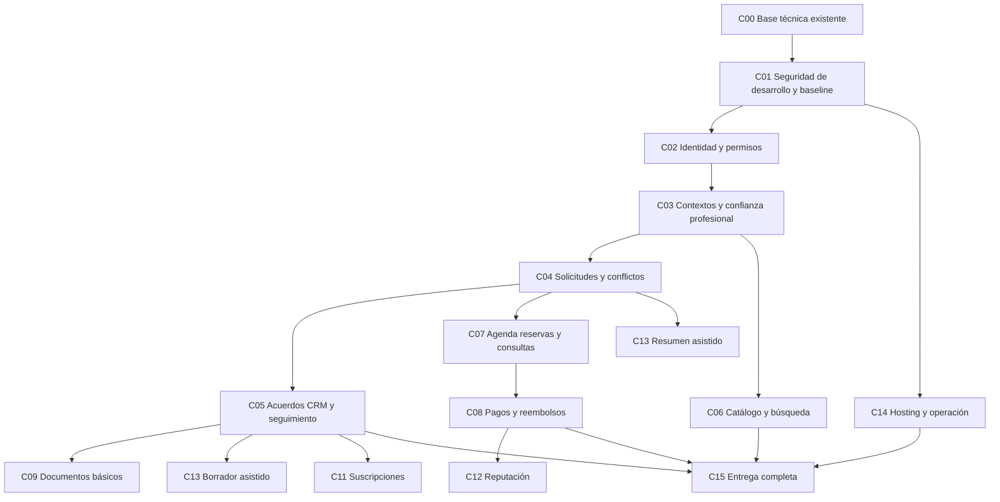

# Plan de desarrollo de Legalia por agentes

## Estado vigente al 2026-10-15

Cuenta APP de ensayo: buzón controlado confirmado por Arturo. Registro privado
por TTY preparado, con presupuesto SMTP original y veinte pruebas sintéticas;
revisión A2 sin bloqueantes. Integración API/SQL:532 pruebas pasan. Ejecución humana
con contraseña/OTP sigue pendiente, sin flags activados ni correos enviados en la
preparación. [Instrucciones](operations/legalia-test-account-registration.md).

Segunda tanda de agent teams completada sobre fe75a8b1f17b: retención coordinada
local C02/C03 con9 pruebas nuevas de límites/concurrencia/FK; harness privado de
aceptación de revocación con19 pruebas sintéticas; error de diccionario de mensajes
corregido en Auth/C03 y22 comprobaciones del cliente. Integración:512 pruebas
API/SQL pasan,31 de herramientas y lint/tipos/build web pasan. Revisión independiente
sin bloqueantes para el alcance actual. No ejecución real del harness ni purga
remota, scheduler o migración C03. Ver [órdenes y resultado](operations/legalia-agent-continuation.md).

La configuración privada de C02 y la conexión del rol runtime con TLS verify-full
están verificadas; publishable ya no requiere copia del operador. Identity y correo
siguen desactivados hasta demostrar entrega OTP y revocación reales. C03 cuenta con
API/SQL/web locales del borrador privado y práctica inactiva; D-041 ya resuelve las
tres preguntas de invitación/revisor/cierre. No se aplicó su migración remota.
484 pruebas API/SQL/herramientas pasan y lint/tipos/build web pasan. Retención C02/C03
coordinada, operación periódica, prueba de retiro Auth y revisión jurídica siguen
pendientes. Los apartados anteriores se conservan como evidencia histórica.
Ver [incremento integrado](operations/legalia-professional-draft-increment.md).

## Estado vigente y reactivación (2026-10-14)

Nombre vigente Legalia (D-038). Las secciones de preparación y destinos anteriores
se conservan abajo como antecedentes; no representan el estado actual.
Referencia común publicada al inicio de esta tanda: `338617a91589`, rama `codex/identity-design`.
Arturo pidió reactivar los agentes para continuar el plan completo. Se asignan
tres trabajos con archivos exclusivos y revisión independiente, sin ampliar
decisiones de negocio ni acceder a secretos o clientes.

| Capacidad | Estado actual | Trabajo inmediato |
|---|---|---|
| C00 Fundación | Implementada localmente | Conservar React Router/Vite + FastAPI y dependencias fijadas |
| C01 Desarrollo seguro | Scanner y controles locales verificados; CI remoto pendiente | Revisión redactada antes de commit/push; integración por coordinador |
| C02 Identity | API/web/SQL local; schema privado y Auth/SMTP/plantillas en Legalia | Endurecer runtime; resolver revocación/probe; verificar correo real y retención |
| C03 Contextos profesionales | PC-01..PC-05 A aprobados (D-040); contratos en revisión | Modelo/matriz/API/UX y primer incremento privado; detalles de invitación/revisor/relevo pendientes |
| C04–C12, C14–C17 | Secuencia funcional pendiente de checkpoints propios | Contratos/diseños según dependencias; no iniciar tablas o UX sustantiva por inferencia |
| C13 IA | Dos recorridos funcionales delimitados; proveedor/tratamiento/límites pendientes | Conservar petición expresa y revisión humana; no transmitir datos jurídicos |
| C18–C19 Ampliaciones | Visión futura | No forman parte de una implementación automática |

Nuevo proyecto vigente `spohytnxscljtitvmdab` / organización `tagovxtvdicxjweeerwi`,
Free/us-east-1. No usar el proyecto anterior ni recursos de Kova. Tres tablas
Identity privadas con RLS FORCE, roles mínimos y once comprobaciones correctas.
Security/Performance Advisor sin errores o advertencias; cinco avisos de índices
nuevos sin uso conservados. SMTP guardado por Arturo y dos plantillas OTP instaladas;
entrega real pendiente. 299 pruebas API/SQL y 31 pruebas de herramientas pasaron
en la tanda anterior; no atribuirlas a cambios posteriores sin volver a comprobar.

C02 todavía no Done: publishable del `.env` privado pendiente de Arturo, validación
HTTP aprobada (D-039) en implementación local, conexiones/TLS/recorrido real,
evidencia de retiro Auth y scheduler de retención pendientes. Dominio aplazado;
remitente de prueba del proveedor no habilita correo a usuarios generales. No
presentar la construcción del producto como piloto. [Evidencia vigente](operations/legalia-supabase-setup.md).

Tanda D-039/D-040: validación HTTP implementada localmente y dominio puro C03
inicial, sin endpoints/persistencia profesionales. 416 pruebas API/SQL/dominio y
31 de herramientas pasan; ver [informe integrado](operations/legalia-approved-implementation-batch.md).

Órdenes activas: [tanda de continuación](operations/legalia-agent-continuation.md).
El coordinador integra y publica los cambios revisados; las decisiones aplicables
de Arturo se registran antes de implementar una capacidad importante nueva.

Fecha: 2026-10-12. Estado: Proposed para la secuencia y arquitectura nuevas. Las
reglas de protección de secretos provienen de la instrucción expresa de Arturo.
Este plan puede asignarse por bloques; no autoriza implementar decisiones pendientes,
contratar servicios ni desplegar. No se han iniciado agentes mediante esta entrega.

Abogalia busca atención legal clara y continua: encontrar quién puede atender,
entender condiciones y saber qué sigue. El desarrollo debe unir solicitudes,
acuerdos y seguimiento para clientes, independientes y despachos pequeños. Cada
capacidad entrega UX, API, datos, permisos y excepciones verificadas. El trabajo
se paraleliza después de acordar contratos y propiedad; las decisiones importantes
siguen en manos de Arturo.

## Avance registrado

La descripción inicial conserva el estado de preparación del plan. Arturo aprobó
las opciones recomendadas de Identity (D-031) y precisó retención de 30/90 días
(D-032). Se inició una tanda de diseño y una de implementación con tres agentes
coordinados. La fundación común quedó en un commit local revisado, sin publicación.

C01 tiene controles locales y CI preparado; CI remoto no se ha ejecutado. C02 está
en integración local: UX, API y almacenamiento de sesiones, con datos sintéticos.
La verificación real del proveedor/correo y la operación de retención siguen
pendientes; no se marca C02 Done. C03–C19 conservan sus decisiones pendientes.
Consultar [tanda 02](operations/identity-implementation-batch-02.md) para evidencia
actual y límites. Ningún recurso remoto fue provisionado o migrado en esta tanda.

## Punto de partida real

| Elemento | Estado que deben respetar los agentes |
|---|---|
| Repositorio | Monorepo público Abogalia; hay cambios locales sin commit/push |
| Frontend | React Router sobre Vite/TypeScript; portada prerenderizada y diagnóstico solo de desarrollo |
| Backend | FastAPI; health local comprobado, sin flujos de negocio |
| Calidad | Lint, tipos y build locales pasan; workflow CI preparado, no ejecutado remotamente |
| Supabase | Organización y proyecto propios Free/us-east-1, saludables y sin tablas public |
| Identidad | Supabase Auth aprobado como proveedor; integración, sesiones y permisos pendientes |
| Aislamiento | Administración con posprojectsupport y espacios por producto aprobados; Kova no se modifica |
| Hosting/correo | Cloudflare/Fly y Resend Free propuestos; selección operativa, presupuesto y configuración pendientes |
| IA | Dos flujos funcionales aprobados; proveedor, costos, retención y transmisión pendientes |

Las referencias vigentes son el [registro de decisiones](decisions/decision-log.md),
el [registro de servicios](operations/service-registry.md), los ADR y los checkpoints.
Los documentos iniciales contienen visión y alternativas; sus estados no se deducen
por antigüedad ni por aparecer en una tabla de alcance. Morelia, prepago universal,
comisiones y un SLA numérico no están aprobados. El nombre sigue en discusión.

## Organización del equipo

Un coordinador integra y conversa con Arturo. Ocho roles especializados se activan
según la capacidad; no necesitan ejecutarse todos a la vez ni ser agentes permanentes.
Recomiendo comenzar con tres agentes de diseño en paralelo y una coordinación.
La concurrencia debe adaptarse a los límites reales del entorno, herramientas y gasto.

| Rol | Responsabilidad | Propiedad de trabajo | Límite |
|---|---|---|---|
| A0 Coordinación | Prioridades, decisiones, contratos, integración y releases | Backlog, índice, registro de decisiones, configuración compartida | No aprobar decisiones de Arturo ni su propia revisión sensible |
| A1 Producto y arquitectura | Recorridos, límites de dominios, modelos conceptuales, estados y checkpoints | Documentos de la capacidad asignada | No decidir precios, permisos, tenencia o reglas comerciales pendientes |
| A2 Seguridad y privacidad | Amenazas, matriz de acceso, política de secretos, revisión independiente | Documentos y pruebas de seguridad asignadas | Sin lectura de secretos o clientes reales; sin cambios remotos por el rol |
| A3 Datos y migraciones | Esquema aprobado, constraints, grants/RLS, migraciones y recuperación de datos | Único escritor de migraciones y diccionario de datos | No crear tablas sin modelo aprobado ni migrar producción automáticamente |
| A4 Backend | Contratos HTTP, autorización, lógica y transacciones de negocio | Módulos FastAPI y sus pruebas | No reimplementar Auth ni ejecutar todo con privilegios administrativos |
| A5 Frontend y UX | Recorridos completos, accesibilidad, estados de error, formularios y cliente API | Componentes/rutas de la capacidad | No inventar endpoints, permisos ni acceso directo a datos privados |
| A6 Plataforma y operación | CI/CD, secretos de runtime, hosting, correo, observabilidad y costos | Workflows, configuración y runbooks asignados | No contratar, publicar ni ampliar accesos sin alcance aprobado |
| A7 QA e integración | Pruebas de contratos, autorización, concurrencia, E2E y recuperación | Suites y evidencia sintética asignadas | No sustituir recorridos reales por mocks ni editar implementación sin coordinar |
| A8 Integraciones | Pagos, suscripciones, correo de aplicación e IA cuando tengan diseño aprobado | Adaptadores y pruebas de la integración asignada | Sin decisiones de proveedor/gasto ni envío externo de información real por inferencia |

La propiedad concreta se asigna por archivo en cada orden, no solo por carpeta.
A4 y A8 no editan el mismo módulo; A2 y A7 no editan la misma suite. A6 prepara
cambios de CI y A0 integra los archivos globales. La revisión final corresponde
a alguien distinto del autor. Una separación escrita no sustituye permisos técnicos.

## Regla de secretos para todas las tareas

El objetivo operativo es que ningún valor secreto entre en la conversación, el
contexto de agentes, Git o sus salidas. Aplicar [AGENTS.md](../AGENTS.md) desde el
primer encargo. Los agentes de diseño trabajan sin credenciales. Los de código usan
datos sintéticos y servicios locales; el acceso remoto empieza en solo lectura y
limitado al recurso cuando el proveedor y la conexión permitan ese alcance.

Las credenciales de runtime, migración y despliegue deben tener funciones distintas.
Usar inyección desde gestores, registrar únicamente nombres y destinos, y reducir
permisos y duración de tokens. Si el proveedor soporta identidad federada/OIDC
para ese flujo, evaluarla antes de almacenar un token permanente. Esta política
coincide con la gestión del ciclo de vida y privilegio mínimo de
[OWASP Secrets Management](https://cheatsheetseries.owasp.org/cheatsheets/Secrets_Management_Cheat_Sheet.html).

Antes de publicar código: escáner local de secretos con salida redactada para cambios
y una revisión inicial del historial; CI con detección adicional; revisar también
artefactos del build, contenedores, sourcemaps y reportes. Evaluar Gitleaks o equivalente
desde su fuente oficial, fijar versión y verificar checksum. No subir resultados
crudos ni crear fixtures con credenciales reales. Un hallazgo verdadero detiene
la publicación; un falso positivo exige evidencia de que el valor no es secreto.

GitHub ofrece escaneo del historial y push protection para patrones detectados.
Comprobar qué funciones están habilitadas en este repo antes de atribuirles protección.
No saltarse un bloqueo ni depender solo de esos patrones.
[Secret scanning](https://docs.github.com/en/code-security/concepts/secret-security/secret-scanning),
[push protection](https://docs.github.com/en/code-security/concepts/secret-security/push-protection).

En CI: permisos mínimos por job, acciones fijadas por SHA, secretos de despliegue
solo en el flujo autorizado, y separación entre validación de PR y release.
Nunca ejecutar código de una PR no confiable con secretos mediante pull_request_target
o un flujo equivalente. Desactivar volcados/debug que puedan exponer valores y
validar redacción con marcadores sintéticos; el masking automático no garantiza
ocultación de todos los formatos.
[GitHub Actions secure use](https://docs.github.com/en/actions/reference/security/secure-use).

No copiar .env entre worktrees ni habilitar MCP administrativos para todos los
agentes. Un worktree es aislamiento de checkout, no una barrera de seguridad. Si
una conexión permite Kova y Abogalia, no presumir que está acotada: limitar uso,
verificar destino por ID y reservar mutaciones al ejecutor autorizado. Registrar
acceso logrado no prueba persistencia de sesión ni permiso para escribir.

Un posible secreto expuesto se reporta por nombre lógico y ubicación, sin repetirlo.
Detener la operación afectada y la publicación, contener, coordinar revocación o
rotación autorizada y revisar destinos afectados. No resolverlo solamente borrando
el archivo. Los incidentes, evidencias privadas y credenciales renovadas no van al
repo público. Estas reglas y escáneres reducen riesgo; no son una certificación
de ausencia absoluta de filtraciones.

## Arquitectura de trabajo propuesta

Conservar los dos desplegables aprobados, web y API. Recomiendo un monolito modular
en FastAPI y PostgreSQL, con límites de dominio y una vía explícita de acceso a
datos. No crear microservicios, Kafka, Redis, warehouse o un servicio por agente.
La distribución del equipo no determina la distribución del runtime.

Antes de integrar Identity, acordar cómo llega la identidad verificada a FastAPI
y a PostgreSQL: sesión en navegador/cookies, CSRF si corresponde, validación JWT,
renovación/revocación y ruta de datos. El diseño debe elegir entre acceso directo
controlado o mediación por API para cada superficie, evitando dos caminos con
reglas distintas. FastAPI verifica firma y claims requeridos; el algoritmo,
issuer, audience y claves confiables se configuran expresamente, sin confiar en
un JWT simplemente decodificado. [Supabase JWT](https://supabase.com/docs/guides/auth/jwts).

No usar user_metadata editable como autorización. La membresía y permisos vigentes
deben comprobarse contra la fuente aprobada; claims firmados también pueden quedar
obsoletos. La pérdida de acceso a un despacho debe impedir acceso nuevo a sus
recursos según el objetivo de revocación acordado. Autorizar cada objeto y acción,
no solo esconder botones. [OWASP Authorization](https://cheatsheetseries.owasp.org/cheatsheets/Authorization_Cheat_Sheet.html).

Grants y RLS son controles distintos. Cada migración deberá hacer explícitos los
permisos por rol, propietario y operación. El proyecto tiene ensure_rls habilitado,
pero la inspección inicial encontró privilegios residuales: no asumir que desactivar
exposición elimina todos los grants. Probar con roles reales sujetos a políticas,
no solo como administrador. TRUNCATE y REFERENCES no están sujetos a RLS;
propietarios y BYPASSRLS requieren atención específica. Las vistas y funciones
también entran en la revisión.
[Supabase Data API security](https://supabase.com/docs/guides/api/securing-your-api),
[PostgreSQL 17 row security](https://www.postgresql.org/docs/17/ddl-rowsecurity.html).

Separar User, perfil público, contexto profesional, cliente de una relación,
LegalRequest, IntakeSubmission, Booking, Consultation y LegalMatter. Una persona
no obtiene acceso a todos los datos por ser cliente o miembro del mismo despacho.
La práctica propia más un despacho está aprobada; propiedad de relaciones, roles,
salida y transferencia deben diseñarse. No crear un cliente global compartido por
todos los abogados ni fusionar los conceptos en case.

Usar contratos API revisados, estados y errores definidos, y documentación OpenAPI
de FastAPI como artefacto comprobable. El mecanismo de generación de tipos TS y
su herramienta se decidirán al preparar contratos; no duplicar tipos manualmente
sin verificación. [FastAPI](https://fastapi.tiangolo.com/features/).

Auditoría y métricas forman parte de cada capacidad. Separar eventos operativos,
de negocio y analíticos; acordar versiones, actor, tiempo y source of truth.
No registrar relatos, documentos, borradores, emails, cookies o tokens en analytics.
Para acciones con efectos externos, diseñar idempotencia y entrega duradera antes
de activarlas; una outbox en PostgreSQL es una opción que requiere su checkpoint.

## Cómo coordinar el código

1. A0 revisa los cambios locales actuales y el alcance del baseline. Ejecutar revisión
   de secretos antes de incorporar archivos explícitos a una referencia común. No
   resetear cambios ni usar la rama remota como si incluyera esta base sin publicar.
2. Cada tarea recibe rama y worktree propios desde esa referencia revisada, más
   contrato, rutas de edición y dependencia exactos. El mismo trabajo no se asigna
   a dos escritores. No incluir archivos locales sensibles en snapshots.
3. A1/A2/A3 preparan diseño, permisos y modelo. A0 concentra las preguntas; Arturo
   aprueba el checkpoint. Registrar decisión y estado sin reabrir lo ya aprobado.
4. A3 implementa y prueba migraciones locales; publica su contrato de datos. A4 y
   A5 pueden avanzar en paralelo con el contrato API acordado. Mocks explícitos
   sirven para trabajo temporal; no cuentan como aceptación integrada.
5. A7 prueba el recorrido integrado; A2 revisa controles. A0 integra cambios pequeños
   y compatibles, actualiza lockfiles y configuración compartida y resuelve conflictos
   con sus autores. Nadie aprueba su propio cambio sensible.
6. A6/A0 realizan operación remota solo dentro del alcance aprobado. Un único flujo
   publica por entorno; probar versiones compatibles de frontend/API y migraciones.
   No ejecutar dos automatismos que promuevan releases por rutas diferentes.

Evitar mantener muchas ramas por meses. Integrar capacidades gradualmente, dejando
inaccesibles los flujos incompletos; ninguna bandera de UI sustituye autorización.
Migraciones compatibles antes de API nueva; cambios destructivos solo con plan de
datos y aprobación aplicable. Rollback de código no deshace automáticamente datos:
preferir expansión/contracción, probar compatibilidad y restauración por separado.

## Secuencia y dependencias

Los identificadores Cxx son unidades de backlog, no decisiones aprobadas. Las
capacidades C02–C19 están pendientes de diseño/implementación aunque parte de su
alcance general esté aprobado. La etapa local C00 ya existe; C01 endurece colaboración.

El diagrama muestra dependencias principales; C10 notificaciones, C16 auditoría/
analítica y C17 operación interna acompañan cada bloque desde su primera entrega.
IA y suscripciones no bloquean un recorrido manual de atención si el checkpoint
de esa entrega lo permite. Descubrimiento y atención con clientes propios pueden
integrarse a ritmos diferentes, sin imponer una consulta o pago artificial.

| Etapa | Resultado | Trabajo paralelizable | Condición para pasar |
|---|---|---|---|
| 0 Preparación | Baseline común, reglas, matriz de decisiones y controles de secretos | A1 diseño, A2 seguridad, A6 propuesta CI | Ningún secreto en entregables; alcances asignados |
| 1 Identidad | Registro/sesiones y autorización por relación/contexto | Datos primero; API/web sobre contrato; QA diseña negativos | Checkpoint Identity aprobado; pruebas de acceso ajeno y revocación |
| 2 Atención | Profesional habilitado, solicitud mínima, evaluación y seguimiento | Perfil/catálogo y relación de servicio en módulos distintos | Condiciones y responsables visibles; rechazo y falta de respuesta resueltos |
| 3 Descubrimiento y transacción | Búsqueda, agenda, consulta, pagos y excepciones | Búsqueda y scheduling; pagos empieza con contrato de reservas | Sin doble reserva ni doble cargo; conciliación y recuperación |
| 4 Recurrencia | Documentos seguros, notificaciones, suscripciones, reputación y dos IA | Solo capacidades con dependencias y decisiones resueltas | Retención, privacidad, cuotas y moderación verificadas |
| 5 Operación real | Release, recuperación, soporte y métricas útiles | Preparación operativa puede avanzar desde etapa 0 | Recorrido público real y restauración comprobados antes de datos reales |
| 6 Ampliación | Gestión jurídica e integraciones avanzadas | Diseñar por beneficio y dependencia | Nuevo checkpoint; sin reactivar automáticamente IA documental aplazada |

No son fechas ni estimaciones de duración. Calendarizar después de aprobar el
primer recorrido de atención y conocer dedicación, presupuesto y dependencias.

## Backlog de capacidades asignables

Cada fila se desglosa en Feature → tareas técnicas cuando se apruebe su checkpoint.
La métrica indicada es propuesta; definición, evento y denominador se acuerdan
antes de instrumentar. Toda medición debe evitar contenido jurídico y PII.

| ID y capacidad | Valor y datos afectados | Responsables y dependencias | Aceptación y métrica propuesta |
|---|---|---|---|
| C00 Fundación | Base reproducible, web/API local | Ya implementada; A0 conserva evidencia | Build y HTTP local verificados; no presentarla como Auth o deployment |
| C01 Desarrollo seguro | Protección de credenciales y trabajo concurrente; sin datos de clientes | A2/A6/A0; sin decisión de negocio | Scan redactado, PR sin secretos, pruebas sintéticas de redacción; hallazgos y resolución |
| C02 Identity | Acceso correcto; User, sesión, consentimientos y permisos conceptuales | A1/A2/A3 → A4/A5/A7; checkpoint | Registro/recuperación, expiración, revocación y acceso ajeno probados; éxito de acceso/recuperación |
| C03 Profesionales y contextos | Confianza y separación; LawyerProfile, Credential, LawFirm, Office, Membership | A1/A2/A3/A4/A5; C02 | Verificación con alcance claro, estados y revisión, salida del despacho sin fuga de práctica propia; tiempo y rechazos de onboarding |
| C04 Solicitud y conflicto | Evitar repetición y revelar solo lo necesario; LegalRequest, IntakeSubmission, Consent | A1/A2/A3/A4/A5; C02/C03 | Destinatario y permisos explícitos, información progresiva, decisión profesional y falta de respuesta; tiempo a respuesta útil |
| C05 Acuerdos CRM y seguimiento | Saber qué sigue; Lead, Client de contexto, relación de servicio, LegalMatter, Task, acuerdo | A1/A3/A4/A5; C04 | Clientes propios y de marketplace distinguibles; responsable, alcance, próximos pasos, notas internas y cierre con acceso correcto; claridad y seguimiento cumplido |
| C06 Catálogo búsqueda y matching | Encontrar opciones pertinentes; PracticeArea, LegalIssue, Jurisdiction, Service, LawyerMatch | A1/A3/A4/A5; C03, C04 para matching de solicitud | Solo perfiles autorizados, filtros/ausencia de oferta, reglas explicables y SEO sin indexar datos privados; opciones útiles por búsqueda |
| C07 Agenda reservas consultas | Menos coordinación; AvailabilityRule/Exception, Booking, Consultation | A1/A3/A4/A5/A7; C03/C04, C05 para seguimiento posterior | Conflictos de horario entre práctica y despacho sin exponer asuntos; concurrencia, zona horaria, cancelar/reagendar/no-show; reservas válidas y dobles reservas |
| C08 Pagos reembolsos | Condiciones y estado de dinero claros; Payment, Refund, conciliación | A1/A2/A3/A8/A4/A5/A7; C07 y reglas comerciales | Verificar firma de webhook, duplicados/desorden, importe/moneda en servidor, conciliación y contracargo; diferencias y reembolsos fallidos |
| C09 Documentos básicos | Archivo correcto con acceso acotado; Document, versión, permisos | A2/A3/A4/A5/A6; C05 y checkpoint Storage | Bucket privado, descarga autorizada, límites/validación, cuarentena/escaneo según diseño, retención y eliminación; errores de acceso/localización |
| C10 Notificaciones | Acción a tiempo; Notification, preferencias y entrega | A8/A4/A5/A6; eventos de cada capacidad, remitente y dominio | Sin detalles sensibles por correo, idempotencia, rebotes/reintento y enlaces sin secretos de terceros; entrega y fallo por finalidad |
| C11 Suscripción y billing | Valor SaaS recurrente; Subscription, plan, entitlement, factura | A1/A3/A8/A4/A5; C02/C05 y monetización aprobada | Derecho de acceso separado de estado del pago, fallos/cancelación/cambio de plan y conciliación; activación/retención/contribución |
| C12 Reseñas y reputación | Confianza verificable; Review, moderación y apelación | A1/A2/A3/A4/A5; C07 y prueba de relación acordada | Elegibilidad, privacidad del asunto, abuso, revisión y respuesta; reseñas elegibles y apelaciones |
| C13 AI-01 y AI-02 | Menos redacción con control humano; texto seleccionado, resultado aceptado, consumo | A8/A2/A4/A5/A7; C04 para resumen, C05 para borrador | Original intacto, edición/descarte y copia manual, sin envío; entrada cambiada, inyección, cuotas/concurrencia/fallo; costo por resultado aceptado |
| C14 Plataforma | Aplicación operable con costo controlado; release y configuración | A6/A0/A2/A7; proveedores/tiers aprobados | Destino propio, HTTPS/proxy/caché correctos, secretos inyectados, observabilidad sin PII, versiones y rollback; errores/latencia/memoria/costo |
| C15 Entrega completa | Atención útil de extremo a extremo | A0/A7/A2; capacidades incluidas en checkpoint de entrega y C14 | Flujos público/cliente/profesional/despacho, fallos, aislamiento y restauración reales; adopción y claridad del siguiente paso |
| C16 Auditoría y analítica | Trazabilidad y aprendizaje; AuditEvent, ProductEvent, contratos | A1/A2/A3/A4/A6/A7; incremental desde C02 | Acceso/retención definidos, sin relatos ni secretos, eventos consistentes y métricas reproducibles; cobertura y calidad de eventos |
| C17 Admin y operación | Atender excepciones con soporte limitado; verificación, reporte, disputa, intervención | A1/A2/A4/A5; incremental según C03/C04/C08/C12 | Permisos mínimos, motivo y auditoría de intervención, apelación/escalamiento con responsable; cola y resolución de incidencias |
| C18 Ampliación jurídica | Gestión jurídica interna futura; actuaciones, plazos, firma y fiscal | A1/A2/A3/A8; C05/C09 y revisión específica | Responsabilidad, fuente de plazo, error y revisión jurídica acordados; sin prometer cálculo automático ahora |
| C19 Integraciones avanzadas | Menos duplicidad; calendario externo, WhatsApp/SMS, exportación/API | A8/A2/A4/A6; capacidades dueñas de datos | Consentimiento/acceso mínimo, sincronización, desconexión, revocación, errores y costo; esfuerzo evitado |

C09 conserva almacenamiento básico. No incluye OCR, embeddings, RAG ni extracción
documental con IA: están aplazados. C18/C19 pertenecen a la visión futura, sin alcance
de implementación ni proveedor aprobado. Los adaptadores no agregan canales por
defecto y no envían mensajes externos durante desarrollo.

## Decisiones que bloquean implementación

Preparar sesiones por bloque; no hacer todas estas preguntas a la vez. A1/A2/A3
presentan alternativas y recomendación y A0 registra las respuestas.

| Sesión | Decisiones a resolver | Bloque que habilita |
|---|---|---|
| Identity y contextos | Registro y roles; usuario con varias funciones; propiedad de relaciones; membresía/salida y permisos; sesión/MFA/revocación; camino de datos | C02/C03 y schema inicial |
| Atención y confianza | Verificación y responsables; datos mínimos/conflicto; destinatarios; tipos de servicio/acuerdo; respuesta/vencimiento y soporte; primer recorrido completo | C03/C04/C05/C17 |
| Catálogo y reserva | Cobertura; servicios y filtros; elegibilidad/ranking; agenda compartida; aceptación/confirmación; cambios y ausencias | C06/C07 |
| Dinero y monetización | Quién contrata/cobra; momento de cobro; proveedor; reembolsos/disputas; suscripción/comisiones; conciliación/fiscal | C08/C11 |
| Documentos y comunicación | Proveedor y límites; acceso/cuarentena; retención/borrado; remitente/dominio; finalidad/preferencias; destinatarios y contenido | C09/C10 |
| IA | Proveedor/modelo; tratamiento y consentimiento; persistencia; cuotas/topes; evaluación; fallos y fallback explícito | C13 |
| Operación y release | Hosting/región/tier; presupuesto y alertas; secretos/acceso; disponibilidad; recuperación/RPO/RTO; promoción y soporte | C14/C15 |

Privacidad, ubicación/transferencia de datos, contratación, intermediación, cobros,
verificación, referencias institucionales y marca: LEGAL REVIEW REQUIRED donde
corresponda. Un agente prepara preguntas y requisitos; no emite certificación jurídica.

## Primeras órdenes listas para asignar

Usar la [plantilla](operations/agent-task-template.md), agregar referencia Git y rutas
concretas, y ejecutar primero T01/T02/T03. Las demás son encargos de diseño que
pueden encolarse. Ninguna requiere credenciales ni tablas nuevas.

| Orden | Rol y objetivo | Entregable específico | Criterio para aceptar |
|---|---|---|---|
| T01 | A1: preparar checkpoint Identity y contextos sin programar | docs/checkpoints/identity-and-contexts.md con las ocho secciones, opciones y hasta seis decisiones; reconciliar contradicciones con IDs | D-003/D-028 preservados, permisos pendientes explícitos, escenarios propios/despacho/cliente incluidos |
| T02 | A2: amenazas y matriz de protección de datos/secretos | docs/security/identity-threat-model.md y docs/security/access-matrix-proposed.md; propuesta de controles locales/CI | Casos de acceso cruzado, escalamiento, sesión obsoleta, filtración por logs/bundles y operación administrativa; sin valores secretos |
| T03 | A3: modelo conceptual y contrato de datos para Identity | docs/data/identity-model-proposed.md, sin SQL ejecutado; propietario, cardinalidades, estados y reglas de acceso | No cliente global ni case genérico; salida de despacho y privilegios residuales considerados; decisiones pendientes enlazadas |
| T04 | A6: plan de CI seguro y baseline de colaboración | docs/operations/secure-development-proposed.md; instrucciones de scanner redactado y revisión de artefactos; diff propuesto de CI | Sin provisioning/login nuevo, instalación o escritura remota; herramientas/versiones verificadas antes de implementación |
| T05 | A4: contrato API de Identity | docs/contracts/identity-api-proposed.md con endpoints conceptuales, errores, actor/contexto y requisitos de JWT | Dependencias T01–T03; no seleccionar aún sesiones/cookies o ruta de DB por inferencia |
| T06 | A5: UX de Identity y cambio de contexto | docs/ux/identity-flows-proposed.md con estados, acceso denegado, recuperación y navegación; sin pantallas productivas | Enlazado al contrato; sin sugerir que cambiar contexto da acceso o que registro verifica al abogado |
| T07 | A7: estrategia verificable de aceptación | docs/testing/identity-acceptance-proposed.md y mapa de tests necesarios | Incluye abuso de IDs/propietario, baja de membresía, sesión revocada, migración y flujo completo; solo datos sintéticos |
| T08 | A8: contratos de futuras integraciones | docs/integrations/dependencies-proposed.md: correo, pagos y dos IA, inputs/outputs, límites y pendientes | No elegir proveedor ni contactar servicios; sin WhatsApp, OCR o agentes jurídicos añadidos al alcance |

T02/T03 hacen referencia al borrador T01 mediante contrato compartido, sin editarlo.
Tras integrar los tres diseños, A0 prepara una sola sesión con Arturo. Una aprobación
del diseño habilita órdenes de implementación por capacidad; no habilita todo el
backlog. A6 puede preparar T04 en la siguiente tanda sin esperar decisiones de negocio.

## Definition of Ready y Definition of Done

Ready para implementar: checkpoint aprobado, decisiones aplicables registradas,
modelo conceptual aprobado si hay tablas, contratos/permisos/estados acordados,
dependencias disponibles, archivos y revisor asignados, criterios de aceptación y
entorno sintético definidos. Ready para diseñar solo exige contexto y alcance.

Done por capacidad:

- Usuario puede completar el objetivo real con validaciones, errores y alternativas
  manuales previstas. No basta una pantalla ni un recorrido feliz simulado.
- API y base aplican permisos, constraints y estados; pruebas negativas demuestran
  aislamiento de clientes, práctica propia, despacho y administración según diseño.
- Pruebas unitarias de reglas relevantes, integración/transacciones, contratos y
  E2E crítico pasan. No crear pruebas que solo repitan una implementación trivial.
- Reservas prueban concurrencia; dinero prueba webhook duplicado/desordenado,
  conciliación y reembolso; IA prueba límites, selección y fallos; documentos prueban
  descarga ajena y cuarentena. Migraciones prueban instalación limpia y upgrade.
- Secretos, logs y artefactos revisados sin valores expuestos; dependencias fijadas,
  acciones revisadas y controles CI necesarios satisfechos.
- Auditoría, eventos, métricas, retención y runbook de la capacidad definidos y
  comprobados donde correspondan. Revisión A2/A7 independiente, sin bloqueantes.
- Documentación y estado reflejan lo ejecutado. Integración local, CI remoto,
  deployment y prueba con proveedor real son evidencias distintas.

Antes de información real: privacidad y términos revisados, permisos probados,
operación de excepciones asignada, restore real con datos sintéticos aislados,
backups definidos, correo correcto y release verificado desde la URL del usuario.
Supabase Free no convierte un backup no probado en recuperación disponible.

## Costos y lecciones de Kova

Desarrollar localmente primero; no mantener máquinas de pago sin aplicación lista
para verificar. Free de Supabase ya existe; hosting, correo, IA y dominio aún deben
reconfirmar tier, cuotas y precio oficial antes de provisionar. No sumar consumo de
agentes o infraestructura como si fuera gratuito, ni prometer una factura máxima.

Las lecciones aplicables son: permisos por tenant medidos en pruebas, frontend/API
compatibles en un release, un único publicador por entorno, comprobación de URL
pública y proxy, trabajo costoso bajo demanda, cuotas compartidas correctamente y
restauración comprobada. Adaptar patrones; no copiar secretos, datos, sesiones,
configuración privada ni automatismos de Kova. [Evidencia](25_kova_lessons_and_setup_order.md).

Crecer por memoria/CPU, latencia, conexiones, errores, costos y necesidades de
disponibilidad medidas. Escalado vertical es el primer candidato para cómputo;
réplicas, colas y servicios nuevos requieren beneficio/operación demostrables y
decisión de presupuesto. No prometer capacidad por una cifra arbitraria de usuarios.

## Uso inmediato

1. Dar a un coordinador este plan y AGENTS.md.
2. Asignar T01, T02 y T03 a agentes distintos en modo diseño y con archivos propios.
3. Integrar esos entregables y resolver Identity con Arturo en una sesión acotada.
4. Distribuir datos/API/web/QA según contratos aprobados y cerrar C02 antes de
   ampliar acceso a información del resto del producto.

Fuentes técnicas consultadas el 2026-10-12 enlazadas junto a cada control. Son
referencias para verificar prácticas; no aprueban nuevas decisiones del proyecto.

Ejecución posterior, 2026-10-12: Arturo solicitó levantar agentes para desarrollar
este plan. T01–T03 se entregaron en diseño con tres agentes; T04 fue preparado por
coordinación. [Asignaciones, revisión y límites de la tanda 01](operations/agent-design-batch-01.md).
Al cerrar la tanda 01, Identity y su modelo quedaron Awaiting decision. Arturo
aprobó después las opciones recomendadas (D-031) y la retención (D-032); se
implementaron flujos y tablas locales en la tanda 02, con verificación y límites
registrados en su evidencia. La capacidad completa conserva pendientes operativos.
