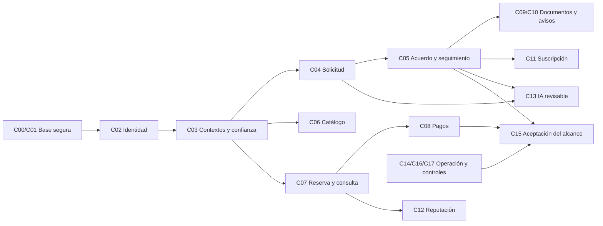

# Plan vigente de Legalia por agentes

Actualizado2026-10-16. Coordinador A0. Rama `codex/identity-design`;
referencia común de esta tanda `4eb597c`, checkout limpio antes de delegar.
Arturo pidió reactivar Agent Teams y terminar el planning restante. Se concretan
los bloques C00–C19 y sus tareas; no se interpreta como aprobación de reglas
comerciales, nuevos permisos, datos, retención, proveedor o gasto pendientes.

El plan anterior se conserva íntegro en el [archivo histórico](27_development_plan_agents_history_2026-10-16.md).
Los estados operativos siguientes sustituyen sus encabezados contradictorios.
Approved no significa Implemented; planning preparado no significa producto terminado.

## Producto, arquitectura y límites ya aprobados

Legalia: atención legal clara y continua para independientes y despachos pequeños,
con relación de servicio como centro y búsqueda gratuita; precios/cotizaciones
profesionales sin fijar importes. Práctica propia y como máximo un despacho por
profesional. Revisión profesional manual, publicación separada y voluntaria,
sin autoaprobación ni lectura jurídica universal por administrar un contexto.
D-001/003/004/011/014/015/016 y D-040/041; revisar el registro antes de implementar.

Monorepo React Router/Vite/TypeScript y FastAPI/Python, Supabase Auth y PostgreSQL
privado. Frontend [publicado](https://legalia-web.legaliasupport.workers.dev/),
Cloudflare Workers Static Assets Free; API en una Fly sharedcpu1x/1GB/iad, sin
réplicas: US$6.70 por30d más transferencia/impuestos aprobados. Supabase/Resend
propios. Sin cambio a Paid ni servicio extra por inferencia. El [registro de servicios](operations/service-registry.md)
solo contiene destinos públicos; `.env` y credenciales nunca se leen o publican.

IA actual: resumen revisable a petición con original conservado y borrador editable
con copia manual. Sin envío automático. Proveedor/modelo/costo/tratamiento/límites
pendientes. OCR, extracción, embeddings e indexación documental con IA aplazados.
C18/C19 son visión futura, no backlog de implementación autorizado en esta entrega.

## Estado comprobado y cierre pendiente

| ID | Capacidad | Estado real | Falta para aceptación/cierre |
|---|---|---|---|
| C00 | Fundación | Monorepo y build implementados | Conservar reproducibilidad y contratos; no confundir health con Auth/DB |
| C01 | Desarrollo seguro | Escáner redactado, dependencias fijadas, checks locales; build/escaneo de imagen remoto probado | Comprobar CI completo en PR/main y controles de publicación; no atribuir ejecución remota no realizada |
| C02 | Identity | API/web/sesiones locales y esquema remoto; Auth/SMTP preparados; registro/acceso públicos habilitados expresamente | Cuenta APP controlada, entrega OTP, MFA, revocación local/global reales; retiro Auth fiable, mantenimiento/retención periódica y restore |
| C03 | Contextos profesionales | PC-01..05 y D-041 aprobados; dominio y primer incremento privado local | Esquema remoto no aplicado; completar/revisar gates de confianza, membresía, relevo y publicación; procedimiento jurídico y capacidades reales pendientes |
| C04 | Solicitudes/conflicto | Checkpoint preparado para decisión | Datos progresivos, destinatario, conflicto y respuesta antes de tablas/UX sustantiva |
| C05 | Relación/acuerdos/seguimiento | Checkpoint preparado para decisión | Alcance, propiedad, aceptación, responsable y cierre de la relación |
| C06 | Catálogo/búsqueda | Búsqueda gratuita aprobada; checkpoint de implementación preparado | Oferta publicable, taxonomía/cobertura/filtros/ranking e invalidación pública |
| C07 | Agenda/reserva/consulta | Checkpoint preparado para decisión | Disponibilidad compartida sin fuga, zona horaria, aceptación y cambios/ausencias |
| C08 | Pagos/reembolsos | Diseño propuesto | Quién cobra/contrata, proveedor, momento, conciliación y excepciones |
| C09 | Documentos básicos | Diseño propuesto; sin IA documental | Propiedad/acceso, storage, límites, cuarentena, eliminación y restore |
| C10 | Notificaciones | Correo Auth preparado; notificaciones de negocio propuestas | Dominio/remitente propio, finalidad/contenido/preferencias, entrega durable y rebotes |
| C11 | Suscripción/billing | Diseño propuesto | Monetización/precios, entitlements y comportamiento ante fallos/cancelación |
| C12 | Reputación | Diseño propuesto | Elegibilidad, confidencialidad, moderación/apelación y prueba de relación |
| C13 | Dos funciones de IA | Flujos aprobados; diseño de entrega propuesto | Proveedor/tratamiento/presupuesto/límites/evaluación antes de enviar texto |
| C14 | Plataforma | Hosting desplegado y probado; cuota Free optimizada; observabilidad preparada sin captura | Restore/rollback operativos, disponibilidad y alertas/retención de observabilidad por decidir |
| C15 | Entrega completa | Plan de aceptación propuesto | Fijar capacidades incluidas y probar recorrido, excepciones, seguridad y restauración reales |
| C16 | Auditoría/analítica | Historia mínima C02/C03 delimitada; marco de producto propuesto | Finalidades, acceso y retención por familia/evento, sin contenido jurídico ni secretos |
| C17 | Operación interna | Responsable inicial y capacidades C03 delimitados; procesos propuestos | Procedimientos, motivo/auditoría, apelación/escalamiento y soporte de alcance limitado |
| C18 | Ampliación jurídica | Aplazada, con criterios de reapertura | Nuevo checkpoint y revisión específica antes de plazos/firma/fiscal |
| C19 | Integraciones avanzadas | Aplazadas, con criterios de reapertura | Proveedor/costo/consentimiento y sincronización/revocación por integración |

Evidencia de base:587 pruebas API/SQL (última ejecución2026-10-15),33 pruebas Node,
9 workerd,11 routing y4 del checker (última ejecución2026-10-16), además de build,
tipos, dry-run y escaneo sin hallazgos. El planning no vuelve a atribuir esas
pruebas a una ejecución nueva ni supone aceptación de correo/MFA/negocio.

## Checkpoints y contratos de cada capacidad

C00/C01: [base](checkpoints/repository-and-empty-database.md),
[desarrollo seguro](operations/secure-development-proposed.md).
C02: [identidad](checkpoints/identity-and-contexts.md),
[sesión activa](checkpoints/identity-session-validation.md),
[activación real](checkpoints/identity-real-activation.md),
[correo](checkpoints/identity-email-operations.md),
[retención](checkpoints/identity-retention-operations.md).
C03: [profesionales/contextos](checkpoints/professional-contexts.md),
[API](contracts/professional-contexts-api.md),
[modelo](data/professional-context-schema.md),
[UX](ux/professional-contexts-flows.md).

| ID | Documento de decisión y tareas |
|---|---|
| C04 | [Solicitudes y conflicto](checkpoints/c04-requests-conflicts.md) |
| C05 | [Relación de servicio](checkpoints/c05-service-relationships.md) |
| C06 | [Catálogo y descubrimiento](checkpoints/c06-discovery-catalog.md) |
| C07 | [Reservas y consultas](checkpoints/c07-bookings-consultations.md) |
| C08 | [Pagos y reembolsos](checkpoints/c08-payments-refunds.md) |
| C09 | [Documentos privados](checkpoints/c09-private-documents.md) |
| C10 | [Notificaciones](checkpoints/c10-notifications.md) |
| C11 | [Suscripciones/billing](checkpoints/c11-subscriptions-billing.md) |
| C12 | [Reseñas/reputación](checkpoints/c12-reviews-reputation.md) |
| C13 | [IA asistiva](checkpoints/c13-ai-assistance-delivery.md) |
| C14 | [Plataforma y operación](checkpoints/c14-platform-operations.md) |
| C15 | [Entrega completa](checkpoints/c15-complete-delivery.md) |
| C16 | [Auditoría/analítica](checkpoints/c16-audit-analytics.md) |
| C17 | [Operación limitada](checkpoints/c17-limited-operations.md) |
| C18 | [Ampliación jurídica futura](checkpoints/c18-legal-expansion.md) |
| C19 | [Integraciones futuras](checkpoints/c19-advanced-integrations.md) |

Cada checkpoint contiene ocho secciones, diseño conceptual y datos, límites,
alternativas pendientes, dependencias y criterios de aceptación. Propuestas de
actores, estados, plazos y propiedad no se convierten en migraciones por estar
escritas. Antes de tablas debe quedar aprobado el modelo, relaciones/propiedad,
estados, clasificación, historia, retención y matriz por acción/objeto.

## Secuencia de implementación propuesta

La secuencia permite trabajar en paralelo sin crear funciones aisladas que nadie
pueda usar. No fija fechas ni ratifica el alcance de una primera entrega pública.

1. **Cerrar base operativa**: aceptación real C02 y primer incremento C03,
   procedimiento de revisión, plan de mantenimiento/retiro/restore. C14/C16/C17
   acompañan estos trabajos; no esperar al final para pensar en seguridad/operación.
2. **Atención y seguimiento**: aprobar el corte C04/C05 y sus fronteras C03/C17;
   destinatario, evaluación progresiva, acuerdo, responsable, próximo paso y cierre.
   Recomendar atención directa primero es una propuesta, no descartar marketplace.
3. **Descubrimiento y coordinación**: C06/C07 con profesionales habilitados,
   búsqueda gratuita y reserva consistente entre práctica/despacho. No cobrar
   automáticamente ni exponer información de terceros para resolver conflictos.
4. **Transacción y continuidad**: C08/C11 tras decisiones comerciales; C09/C10
   según necesidades del recorrido. Storage, notificación, pago y suscripción son
   contratos separados, no una compra de suite ni un único permiso genérico.
5. **Confianza y asistencia**: C12 cuando exista relación que pruebe elegibilidad;
   C13 después de aprobar proveedor/tratamiento/topes. Conservar recorrido manual.
6. **Aceptar la entrega**: C15 contra el alcance acordado, con negativas de acceso,
   errores, versiones compatibles, copia/restauración y operación reales.
7. **Reabrir futuro por necesidad**: C18/C19 solo con nuevo checkpoint específico;
   no activación por terminar las capacidades anteriores.

El diagrama no exige pago para todo cliente ni IA/suscripción para todo recorrido.
C15 debe precisar qué variantes promete la entrega y cuáles siguen sin habilitar.

## Equipo, órdenes y tareas listas para el siguiente bloque

Tres agentes y un coordinador, máximo de concurrencia de esta sesión. Para este
planning usan el checkout asignado con archivos exclusivos; no leen `.env`,
secretos, clientes o recursos Kova y no hacen operaciones remotas. A0 integra,
controla índice/decisiones/configuración y realiza commit/push revisados.

| Agente | Propiedad exclusiva de esta tanda | Entrega verificable |
|---|---|---|
| planning_attention | Checkpoints C04–C07 y handoff propio | Modelos/estados/UX y datos propuestos, negativas, tareas y decisiones agrupadas |
| planning_services | Checkpoints C08–C13 y handoff propio | Proveedores/reglas pendientes explícitos, dependencias, idempotencia/privacidad y aceptación |
| planning_operations | Checkpoints C14–C19 y handoff propio | Cierre C00–C03, operación, aceptación, futuro aplazado y revisión transversal |
| A0 | Este índice, archivo histórico, resumen de integración y decisiones | Cobertura20capacidades, referencias válidas, coherencia de aprobaciones y publicación segura |

[Integración y órdenes siguientes](operations/legalia-planning-remaining-2026-10-16.md).
Una tarea de implementación deberá especificar archivos/contrato/dependencias,
checkpoint aprobado, criterios verificables y revisor independiente. A3 es el único
escritor de migraciones. La siguiente tanda se reparte por capacidad aprobada,
no por una lista libre de pantallas, tablas o endpoints.

## Sesiones de decisión

A0 agrupa como máximo5–8 decisiones por sesión y nunca pregunta de nuevo lo ya
aprobado. Las recomendaciones de los handoffs son propuestas; se presentan por
bloque conforme se necesiten, sin pedir autorización global del producto.

| Sesión | Qué resuelve | Qué habilita |
|---|---|---|
| S1 Atención y confianza | Corte inicial, revisión profesional operable, destinatario/conflicto, información progresiva, acuerdo/seguimiento y política de datos correspondiente | Primer incremento completo C03/C04/C05/C17 |
| S2 Descubrimiento y agenda | Cobertura/taxonomía, publicación/filtros/ranking, reserva/zonas/cambios | C06/C07 |
| S3 Dinero | Contratante/cobrador, proveedor, momento/importes, reembolsos/disputas y suscripción/entitlements | C08/C11 |
| S4 Documentos y avisos | Storage, límites/cuarentena, acceso/retención; dominio/remitente/contenido y preferencias | C09/C10 |
| S5 Confianza posterior e IA | Elegibilidad/moderación; proveedor/tratamiento/topes de los dos flujos asistivos | C12/C13, en bloques separados si supera8 decisiones |
| S6 Operación y aceptación | Responsables/alertas, recuperación y alcance verificable de release; sin reabrir hosting aprobado | C14/C15/C16/C17 |

Los plazos30/90 de C02/C03 no se extienden a relatos/documentos/pagos por analogía.
Las invitaciones C03 internas24h/recibo30d/audit90d, revisor manual con MFA sin
self-review y resolución excepcional separada ya están aprobados (D-041).

## Reglas de integración y criterio de terminado

- Nunca secretos en chat/Git/salidas/artefactos; inyección privada y escaneo redactado
  antes de commit/push/publicación. Un hallazgo real detiene la operación afectada.
- Baseline común revisado, archivos exclusivos y contratos antes de paralelizar
  implementación. No sobrescribir cambios ajenos ni usar git add .
- Auth/MFA no reemplaza autorización por objeto/acción/contexto vigente. Probar
  retirada concurrente y aislamiento entre práctica, despacho y relación de cliente.
- UI/mocks/diseño no acreditan funcionalidad completa. Verificar datos/transacciones,
  errores y recorrido; distinguir pruebas sintéticas de aceptación real.
- Cierre de cuenta/retención no se automatizan sin prueba fiable de retiro Auth;
  restaurar no debe revivir accesos retirados ni publicaciones eliminadas.
- Para Done: alcance aprobado, UX/API/datos integrados, seguridad y negativos,
  datos/retención, operación/soporte y evidencia reales según la capacidad.
- Revisión jurídica mexicana cuando corresponda: **LEGAL REVIEW REQUIRED**.

Fuente de autoridad: [decisiones](decisions/decision-log.md), instrucción directa
de Arturo y checkpoints aprobados. Este índice ordena el trabajo; no crea
aprobaciones de negocio, proveedores, gasto o tratamiento de información.
