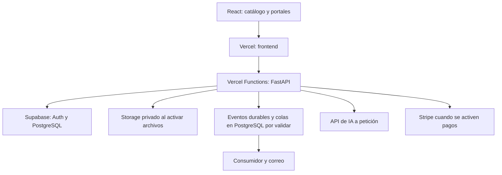

# Checkpoint — Base técnica y suite de React + FastAPI

Fecha: 2026-10-12. Stack React + FastAPI: Approved, D-025 y ADR-001. Servicios y configuración: Discussing, D-026. No se han creado recursos ni código. Tarifas oficiales consultadas durante esta sesión; USD salvo indicación explícita. Este checkpoint reemplaza la propuesta de backend TypeScript integrado en Workers, que no fue aprobada.

> Revisión posterior: la propuesta inicial vigente, con Supabase/Resend Free y hosting pequeño semejante a Kova, está en [suite inicial pequeña](platform-foundation-low-cost.md). Los escenarios de Vercel aquí se conservan para comparación; no son mínimos obligatorios.

## Lo que entiendo

Abogalia necesita catálogo público, portales privados y operación de relaciones de servicio para clientes, independientes y despachos pequeños. Arturo eligió React + FastAPI para dar continuidad a lo aprendido en Kova y pide una suite nueva con presupuesto verificable. La elección de frameworks no autoriza copiar cuentas, datos o secretos ni contratar servicios. Arturo pide conservar semejanza con Kova y mejorar lo que sea posible; esta revisión no cambia React + FastAPI aprobados.

La recomendación actual propone React y FastAPI en Vercel Pro, con PostgreSQL en Supabase. Tras la pregunta de Arturo sobre costo y escalado vertical, se corrige el dimensionamiento inicial: Resend Free dentro de sus cuotas, una Micro de producción y desarrollo/pruebas locales aisladas. La base propuesta es US$45 mensuales; los escenarios anteriores de US$65–75 incluían correo pagado y, en el segundo caso, otra base alojada. No eran requisitos mínimos. La comparación previa Cloudflare/Fly queda como alternativa; se había omitido FastAPI en Vercel y esa omisión se corrigió al revisar la documentación vigente. El catálogo necesita una estrategia de renderizado adecuada para descubrimiento; React Router en modo framework es una opción de frontend, mientras las reglas de negocio permanecen en FastAPI. La elección de React no aprueba todavía Vite, React Router, SSR ni diseño de navegación.

## Decisiones tomadas

- React para interfaz y FastAPI sobre Python como backend central, D-025 y [ADR-001](../decisions/ADR-001-react-fastapi.md).
- Suite propia y lecciones verificadas de Kova, D-023 y D-021.
- Atención clara y continua y relación de servicio como centro, D-011 y D-015.
- Independientes y despachos pequeños; práctica propia más un despacho, D-014 y D-003.
- Autoservicio con soporte limitado y checkpoints, D-004 y D-005.
- Dos funciones de IA y revisión humana aprobadas, D-019 y D-020; procesamiento documental con IA aplazado, D-022.

## Decisiones pendientes

| Bloque | Recomendación | Pendiente |
|---|---|---|
| Hosting y frontend, Q-022 | Dos proyectos Vercel para React y FastAPI en un mismo equipo Pro | Renderizado, sesiones, conexiones, límites, región y releases coordinados tras validar recorrido |
| Identidad y datos, Q-020 | Supabase Auth y PostgreSQL | Integración con FastAPI, sesiones, contexto independiente/despacho, permisos y MFA |
| Operación y presupuesto, Q-021 | Vercel, Supabase y Resend; base US$45 producción o ≈US$55 con otra Micro de pruebas; correo Free dentro de cuota | Techo global, consumo compartido, disponibilidad y objetivos de recuperación |
| Integraciones | Resend Free mientras haya margen de cuota; API de IA y Stripe por capacidades | Tratamiento, retención, evaluación, monetización y flujos de pagos |

Los servicios, precios internos del producto y políticas de datos no se consideran aprobados por solicitar su presupuesto. **LEGAL REVIEW REQUIRED** en tratamiento de datos jurídicos y diseño de pagos; los respectivos checkpoints siguen pendientes.

## Diseño propuesto

### Suite y costo por componente

| Componente | Producción propuesta | Producción más entorno de pruebas |
|---|---:|---:|
| Vercel Pro, frontend React y API FastAPI, un seat de despliegue | US$20 | US$20 |
| Supabase Pro: una Micro de producción; otra Micro de pruebas en el segundo escenario | US$25 | ≈US$35 |
| Resend Free, correo: 3,000 al mes y máximo 100 diarios | US$0 | US$0 |
| Sentry Developer, una persona operadora | US$0 dentro de cuota | US$0 dentro de cuota |
| UptimeRobot Free, comprobaciones externas cada cinco minutos | US$0 | US$0 |
| GitHub Actions, dentro de cuota de runners estándar y almacenamiento | US$0 | US$0 |
| Turnstile Free y DNS Cloudflare Free | US$0 | US$0 |
| Eventos y tareas breves: Supabase Queues/Cron por validar | Sin suscripción separada propuesta; consume base y ejecución | Igual |
| R2 Standard para copias independientes, dentro de cuota gratuita | US$0 condicionado | US$0 condicionado |
| **Subtotal de bases calculado** | **US$45** | **≈US$55** |

No incluye IA, dominio, comisiones de pagos, impuestos ni excedentes. Tampoco incluye proveedores adicionales para firma, WhatsApp, SMS, videollamadas, verificación o facturación fiscal: no están seleccionados. Las funciones y previews de producción y pruebas comparten consumo del equipo Vercel; no requieren una VM de staging con cuota mensual propia. Esa ejecución no es ilimitada ni gratuita fuera de crédito.

**Supuestos verificables:** Vercel Pro tiene cuota US$20, un seat de despliegue y US$20 de crédito de consumo compartido. Instancias de Functions, builds, memoria, invocaciones y otros recursos pueden excederlo. No se añade US$20 por cada proyecto ni otro crédito por tener dos. [Vercel Pro](https://vercel.com/docs/plans/pro-plan). FastAPI tiene soporte en Python Functions: [guía oficial](https://vercel.com/docs/frameworks/backend/fastapi). Proponer dos proyectos del monorepo permite conservar APIs independientes y releases coordinados sin exigir Services. [Monorepos](https://vercel.com/docs/monorepos). Services agrupa componentes en un despliegue pero sigue en beta; es alternativa que requiere decisión y validación, no una dependencia aprobada. [Services](https://vercel.com/docs/services).

Cloudflare se mantiene como candidato para DNS Free, Turnstile y copias R2; esos usos no implican contratar Workers Paid. Si se elige Cloudflare Queues o Email Sending, su plan Paid añade al menos US$5. [Workers pricing](https://developers.cloudflare.com/workers/platform/pricing/), [Cloudflare Free](https://www.cloudflare.com/plans/free/).

Resend Pro no se propone como pago inicial obligatorio: comenzar con Free si acceso, recuperación y notificaciones caben con margen en 100 correos diarios y 3,000 mensuales; preparar alertas y cambiar antes de agotar esas cuotas. Supabase Pro incluye US$10 de crédito de cómputo para una Micro; otra Micro añade aproximadamente US$10. Auth y Storage se proponen en esos proyectos y dentro de sus cuotas, no como capacidad infinita ni proveedores ya aprobados. [Supabase pricing](https://supabase.com/pricing). Resend Pro incluye 50,000 correos mensuales por US$20 y elimina el límite diario del plan Free; su excedente publicado es US$0.90 por 1,000 cuando se habilita. [Resend pricing](https://resend.com/pricing).

Sentry Developer permite una persona; Team cuesta US$29 con pago mensual si necesitamos varios operadores. [Sentry pricing](https://sentry.io/pricing/). UptimeRobot confirma que Free admite uso comercial y ofrece 50 monitores y comprobaciones de cinco minutos; no equivale a vigilancia continua. [Condiciones oficiales de Free](https://help.uptimerobot.com/en/articles/11604710-who-should-use-uptimerobot-s-free-plan). GitHub Free para organizaciones incluye 2,000 minutos mensuales y 500 MB de artefactos; las cuotas se aplican a la cuenta propietaria y los excedentes tienen coste. No se descuentan por inferencia créditos de Kova. [GitHub Actions billing](https://docs.github.com/en/billing/concepts/product-billing/github-actions). Turnstile Free admite aplicaciones de producción. [Planes](https://developers.cloudflare.com/turnstile/plans/).

Para tareas breves se propone evaluar Supabase Queues/Cron y consumidor acotado en FastAPI. Persistir eventos, controlar reintentos y evitar duplicados sigue siendo necesario. Comparten cómputo PostgreSQL y generan ejecuciones de Functions; una cola no ejecuta trabajo por sí sola ni un BackgroundTask garantiza duración indefinida. [Queues](https://supabase.com/docs/guides/queues), [Cron](https://supabase.com/docs/guides/cron). Cloudflare Queues es alternativa, pero añade Workers Paid si no existe otro uso pagado. No se contrata de inicio por inferencia.

R2 Standard ofrece 10 GB-mes, un millón de operaciones A y diez millones B gratuitos por mes. Almacenamiento adicional cuesta US$0.015/GB-mes; operaciones y red de origen deben contarse. Las copias necesitan un job de ejecución presupuestado dentro de CI o cómputo disponible, retención, cifrado y pruebas de recuperación. [R2 pricing](https://developers.cloudflare.com/r2/pricing/). Supabase incluye backups diarios de siete días, pero no los archivos de Storage. [Backups](https://supabase.com/docs/guides/platform/backups).

### Alternativa de correo y escenarios

Cloudflare Email Sending, todavía en beta, incluye 3,000 correos mensuales en Workers Paid y cobra US$0.35 por 1,000 adicionales. Las cuentas nuevas tienen cuotas diarias variables. Puede sustituir Resend tras validar entrega y SMTP con el acceso elegido; no se contratan ambos por defecto. En la suite Vercel requiere añadir al menos US$5 de plan Workers. Frente al escenario con Resend Pro reduciría US$15 de base; frente a Resend Free agregaría US$5. No es un ahorro inicial frente a Free. [Servicio](https://developers.cloudflare.com/email-service/), [precios](https://developers.cloudflare.com/email-service/platform/pricing/), [límites](https://developers.cloudflare.com/email-service/platform/limits/).

| Comparación anterior, con Resend Pro contratado | Producción | Con base de pruebas |
|---|---:|---:|
| Vercel para React y FastAPI | US$65 | ≈US$75 |
| Cloudflare Paid y Fly: dos API producción y una API pruebas cuando corresponda | US$63.40 | ≈US$80.10 |
| Vercel para React y Fly para FastAPI | US$78.40 | ≈US$95.10 |

Son bases, no facturas comparables ya medidas. Fly se calcula a US$6.70 por máquina de 1 GB, iad/ewr y 30 días, con cargos propios adicionales; Vercel factura consumo compartido. Si una alternativa sin hosting Cloudflare conserva Queues allí, añadir al menos US$5. [Fly pricing](https://docs.fly.io/about/pricing).

El margen previo de US$100 no es un requisito mínimo ni presupuesto aprobado. La propuesta inicial revisada parte de US$45 de base para producción, sin correo pagado ni segunda base alojada obligatoria; añadir margen de consumo según el techo que Arturo elija. Durante construcción usar desarrollo y pruebas locales, sin cuotas de producción anticipadas. Una base alojada de pruebas separada eleva la base a aproximadamente US$55 cuando sea necesaria. Sentry Team agregaría US$29 y exigiría revisar esa reserva. Desarrollo completamente local puede evitar cuotas de hosting y base; no es el entorno de producción.

### Arquitectura por módulos

FastAPI concentra reglas y autorización; el frontend contiene presentación. Los módulos separan identidad, contextos, solicitudes, agenda, relación de servicio, pagos, documentos, notificaciones y auditoría. Se propone registrar cambio de negocio y evento pendiente en una transacción y publicarlo después, con recuperación si falla la publicación. Duplicados y reintentos se manejan explícitamente; una cola no garantiza ejecutar una sola vez.

Búsqueda pública inicialmente con filtros e índices PostgreSQL. Reservas y cobros requieren transacciones, restricciones e idempotencia; no se garantiza consistencia por desplegar más máquinas. Las llamadas de IA breves usan API externa y no requieren servidor de inferencia o ingesta documental propio.

### Consumo que se añade

OpenAI Standard, contexto corto, publica para GPT-6 Luna US$0.10 por millón de tokens de entrada y US$0.50 por millón de salida. Como cálculo, 1,000 generaciones de 3,000 tokens de entrada y 500 de salida facturable serían US$0.55; no incluye reintentos, herramientas, caché, primas o impuestos ni confirma que el modelo supere evaluación. [Tarifas](https://developers.openai.com/api/docs/pricing).

Stripe México publica 3.6% + MXN3 para tarjetas nacionales; Billing añade 0.7% de su volumen, con comisiones sin IVA. [Tarifas](https://stripe.com/mx/pricing). Connect para liquidar honorarios depende del modelo: la opción con precios controlados por plataforma publica MXN35 por cuenta activa mensual y 0.25% + MXN12 por transferencia. No se cobra necesariamente en todos los usos de Stripe. [Connect](https://stripe.com/mx/connect/pricing).

Dominio y renovación deben cotizarse al elegir nombre y extensión; no hay importe verificado todavía. Consumo Vercel, ampliación de base, Storage, correo, colas, CI y telemetría pueden añadir cargos. El Spend Cap de Supabase no cubre todo el cómputo. [Control de costos](https://supabase.com/docs/guides/platform/cost-control).

## Datos afectados

Identidad, membresías, solicitudes, relaciones, reservas, archivos, pagos, eventos y auditoría. No se crean ni aprueban tablas o políticas de retención aquí. PostgreSQL sería fuente de operación; las copias, logs y métricas tienen finalidades y acceso separados. Un relato resumido no certifica hechos ni una redirección de pago acredita cobro.

## Seguridad

- Comprobar sesión y contexto profesional en FastAPI y aislamiento en base; rol de aplicación separado del propietario, con políticas y transacciones verificadas. El proveedor de identidad aún debe aprobarse.
- Proponer MFA y recuperación para profesionales y administración en el checkpoint correspondiente; no inferir acceso general a expedientes para un operador.
- Evitar caché pública de respuestas privadas, claves en navegador y contenido jurídico en telemetría.
- Separar claves y datos de producción y pruebas. Pruebas con información sintética; restauración verificada antes de operar.
- Validar webhooks, autorización entre servicios y consumo concurrente. Las colas contendrán identificadores y contexto mínimo; el consumidor volverá a comprobar permisos cuando corresponda.
- Definir carga segura, recuperación de archivos y retención antes de activar Storage; no se aprueba OCR ni indexación.

## Impacto futuro

Functions puede aumentar ejecuciones manteniendo estado en PostgreSQL. Los pools de conexión crecen con cada instancia: hay que controlarlos contra capacidad de base. El escalado de API no elimina límites o fallos de la base única. Medir latencia, cold starts, carga y consumo desde México antes de seleccionar región y declarar capacidad. El runtime impone límites de duración y payload; para archivos grandes se propone carga directa autorizada a Storage. [Límites](https://vercel.com/docs/functions/limitations).

Escalar verticalmente significa aumentar CPU o memoria del mismo servicio. Supabase Pro puede empezar con Micro: US$25 de organización, US$10 de cómputo cubiertos por US$10 de crédito. Cambiar esa única instancia a Small (US$15 de cómputo) eleva esa base a aproximadamente US$30, no obliga a Team ni a crear otra base. Functions usa capacidad por demanda, con límites de memoria y consumo; no equivale a redimensionar una VM permanente. Dimensionar con latencia, conexiones, CPU y memoria medidas, no con una cifra arbitraria de usuarios. [Cómputo y tarifas](https://supabase.com/pricing).

Optimizar consultas e índices antes de aumentar cómputo; separar lecturas, búsqueda, analítica o jobs cuando mediciones lo justifiquen. Un proceso pesado futuro necesita cómputo presupuestado y su propio diseño. Los límites operativos y criterios de recuperación siguen pendientes; no se promete un número de usuarios sin carga representativa.

## Implementación propuesta

1. Ratificar servicios, renderizado, identidad y presupuesto; React + FastAPI ya están aprobados y no se vuelven a preguntar.
2. Preparar desarrollo local y CI, contratos API y pruebas con PostgreSQL real, con versiones fijadas y sin provisionar producción antes de necesitarla.
3. Diseñar e implementar identidad, contextos y permisos aprobados; correo y recuperación antes de invitar clientes.
4. Coordinar releases de frontend y API, migraciones y rollback; medir errores y disponibilidad, probar restauración y fallos de un componente.
5. Entregar el recorrido de atención acordado e incorporar notificaciones, IA, archivos y pagos mediante sus checkpoints.

Verificación cuando exista código: aislamiento, expiración y recuperación de sesión, compatibilidad de releases, concurrencia de reservas y cuotas, duplicados, fallos de proveedores y carga representativa. No se marca Implemented ninguna capacidad por aprobar stack o preparar una suma de tarifas.
