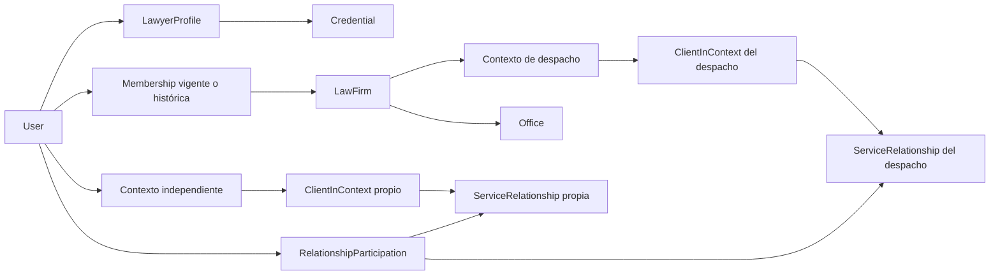

# Modelo conceptual y contrato de datos — Identity y contextos

Fecha: 2026-10-12. Estado: **Proposed, diseño T03 / A3 para C02–C03**.
Revisor asignado: A0. No hay esquema físico, SQL ejecutable, tablas, migraciones
ni integración Auth en esta entrega. Este documento no concede permisos ni cambia
estados del registro de decisiones.

Referencia de trabajo: rama `codex/identity-design`, HEAD
`c71fea298742a43994cf6026494ded080b3ef50d`, con base local sin commit preservada.
El checkpoint [Identity y contextos](../checkpoints/identity-and-contexts.md),
preparado por T01, concentra IC-01–IC-06. Este contrato queda sujeto a su aprobación.

## Actualización de aprobación

D-031 registra la aprobación de Arturo de las recomendaciones A de T01 y del
modelo/matriz recomendados para Identity. D-032 fija 30 días para cuenta cerrada
/evidencia mínima de membresía terminada y 90 días para auditoría, con eliminación
/anonimización posterior. Esta actualización supera el estado pendiente de esas
partes en el borrador; no aprueba superficies F/C03–C19 ni plazos ausentes para
datos jurídicos o evidencia profesional. Implementación y pruebas reales pendientes.

## Alcance y decisiones vigentes

D-003 permite práctica independiente y pertenencia a **un despacho por abogado**.
D-028 aprueba Supabase Auth como proveedor. D-025/D-030 conservan React Router
sobre Vite, FastAPI y el monorepo. D-029 acredita solo proyecto vacío; no acredita
autorización ni datos de negocio. D-015 centra el servicio en una relación.
Consulta: [decisiones](../decisions/decision-log.md),
[plan](../27_development_plan_agents.md) y
[checkpoint de base](../checkpoints/repository-and-empty-database.md).

Son pendientes: métodos de registro, funciones simultáneas, permisos concretos,
propiedad de relaciones, membresía/salida, sesiones/MFA/revocación y camino de
datos. Clasificación, historia y retención también requieren aprobación antes
del esquema. Las recomendaciones siguientes son opciones para A0 y Arturo.
Tratamiento de datos personales y jurídicos: **LEGAL REVIEW REQUIRED**.

## Vocabulario y separación de responsabilidades

«Titular de la cuenta», «responsable operativo», «ámbito propietario del registro»
y «responsable legal del tratamiento» representan conceptos distintos. Un autor
o responsable asignado no se convierte por ello en propietario ni recibe todos
los permisos. La propiedad propuesta determina el ámbito de autorización;
no declara propiedad jurídica sobre información de una persona.

| Concepto | Propiedad operativa propuesta y propósito | Cardinalidad propuesta | Estado y clasificación propuesta | Pendiente |
|---|---|---|---|---|
| User | Cuenta de Abogalia vinculada al sujeto autenticado; datos mínimos de aplicación | Un sujeto de Auth → como máximo un User activo; un User → un sujeto de Auth | Pendiente de activación, activo, restringido, cierre solicitado, cerrado; identidad privada | IC-01/IC-02/IC-05; vinculación, cierre y reconciliación |
| LawyerProfile | Perfil profesional personal; edición de campos propios separada de verificación y publicación | User → 0..1 perfil profesional en el alcance inicial | Borrador, enviado a revisión, corrección requerida, publicable, suspendido, retirado; proyección pública y atributos privados separados | IC-02 y posterior C03; criterios de habilitación y publicación |
| Credential | Declaración y evidencia de una credencial profesional; revisión por actor habilitado | LawyerProfile → 0..N credenciales, cada credencial pertenece a un perfil | Declarada, en revisión, validada con alcance, rechazada, vencida, revocada; evidencia restringida | C03; documentos permitidos, revisor y significado de validación |
| ProfessionalContext | Ámbito donde se opera: práctica independiente o despacho, nunca permiso por sí mismo | Práctica → un responsable profesional; despacho → una LawFirm; recursos → un ámbito propietario explícito | Preparación, activo, suspendido, cerrado; metadatos privados excepto proyección aprobada | IC-03/IC-04; semántica de tenencia y delegación |
| LawFirm | Organización profesional, distinta de sus integrantes | LawFirm → un contexto; 0..N membresías y oficinas | Preparación, activa, suspendida, cierre solicitado, cerrada; contacto público separado de operación privada | IC-04 y C03; creador, control y cierre |
| Office | Sede de un despacho; no es un tenant adicional ni habilita acceso automático | Office → una LawFirm; LawFirm → 0..N Office | Borrador, activa, inactiva; dirección publicada solo por diseño de C03 | C03; relación con práctica propia y exposición |
| Membership | Relación entre User y despacho; alcance funcional y vigencia explícitos | User → 0..N membresías históricas; abogado → 0..1 despacho activo; LawFirm → 0..N integrantes | Invitada, activa, suspendida, finalizada; identidad organizacional privada | IC-02/IC-04; invitaciones simultáneas, facultades y salida |
| ClientInContext | Registro de cliente dentro de un contexto; no directorio global de clientes | Contexto → 0..N clientes; cliente contextual → 0..1 User vinculado inicialmente | Sin vínculo, vínculo pendiente, vinculado, archivado; datos personales y posible información jurídica restringida | IC-03 y C05; vínculo, representación, duplicados y borrado |
| ServiceRelationship | Relación de servicio con ámbito propietario y participantes explícitos | Contexto → 0..N relaciones; cliente contextual → 0..N relaciones; relación → 1 cliente principal propuesto y 0..N participantes autorizados | Estados contractuales en C05; identidad/participación privada y contenido jurídico restringido | IC-03/C05; varios clientes, representante, responsables y acceso |
| RelationshipParticipation | Vínculo de acceso a una relación concreta, separado de Membership | User → 0..N participaciones; relación → 0..N participantes | Propuesta, activa, suspendida, retirada; permisos y ámbito privados | IC-03/IC-04; acciones por participante y efectos de salida |
| ConsentRecord | Evidencia mínima de finalidad, versión y aceptación o retirada; no permiso universal | User o participante identificado → 0..N registros por finalidad | Otorgado, retirado, sustituido; evidencia privada | IC-01 y checkpoints de cada tratamiento; legitimación y retención |
| AuthorizationHistory | Historia mínima de cambios de acceso; sin copiar cargas jurídicas ni credenciales | Objeto de autorización → 0..N eventos | Eventos con actor, acción, objetivo, instante y versión; seguridad restringida | IC-04/IC-05/C16; lectores, plazos y minimización |

Estas son entidades conceptuales, no nombres de tablas aprobadas. Cardinalidades
de User y ClientInContext son recomendaciones iniciales: no resolver por correo
coincidente, ni fusionar automáticamente personas, representantes o cuentas.
La unicidad de despacho activo aplica al abogado según D-003; IC-02 debe definir
cómo se trata a personal que no ejerce como abogado. No deducir ese límite para
otros actores ni permitir dos membresías activas del abogado por concurrencia.

La sesión la gestiona Supabase Auth. IC-05 A propone custodia de tokens en servidor
y sesión opaca de aplicación; almacenamiento, renovación y revocación siguen por
diseñar. Esa infraestructura sensible queda separada de los datos del dominio y
no va a perfiles, auditoría, fixtures ni salidas. No se propone duplicar passwords
o secretos MFA. Si IC-05 exige una referencia local de
revocación, deberá contener únicamente el identificador interno necesario,
estado/versión y vigencia, con acceso restringido; su necesidad no está aprobada.

El diagrama no concede lectura transitiva. Dos registros contextuales pueden
representar a la misma persona sin compartir relato, notas, adjuntos o permisos.
El vínculo a User requiere prueba y finalidad aprobadas; no revela al profesional
las otras relaciones que ese usuario mantiene. Un cliente sin cuenta es una
alternativa pendiente para C05, no una autorización de importación de datos.

LegalRequest, IntakeSubmission, Booking, Consultation y LegalMatter conservan
identidad, destinatario y ciclo de vida propios en C04/C07/C05. No hay entidad
genérica `case`. Sus referencias futuras a contexto/relación deben comprobar
compatibilidad de ámbito, sin crear ahora esas entidades o sus estados.

## Contrato conceptual verificable

1. **Identidad:** el actor proviene de autenticación verificada; no de un User enviado
   por el navegador. La correlación con el proveedor es estable y única. Acordar
   recuperación ante alta parcial sin dejar registros que concedan acceso.
2. **Ámbito:** cada objeto privado tiene un propietario operativo explícito.
   Identificadores opacos no son controles de acceso. El servidor verifica que
   cada referencia pertenece al ámbito permitido antes de leer o cambiar datos.
3. **Contexto elegido:** es una preferencia de trabajo. Elegir otro contexto, alterar
   un identificador o conservar una pestaña abierta no otorga pertenencia.
4. **Acceso:** se evalúan actor vigente, acción, objeto, estado, ámbito y vínculo
   específico. Una membresía activa no basta para acceder a toda relación del
   despacho; el conjunto de permisos debe resolver IC-03/IC-04.
5. **Mutación:** autorizar tanto el objeto actual como el resultado. Cambiar ámbito,
   propietario, verificación o privilegios requiere una operación específica,
   con aprobación funcional y trazabilidad; no edición general de atributos.
6. **Historia:** actor creador y responsable actual son campos distintos. Una salida,
   cierre o suspensión conserva trazabilidad según retención aprobada, sin
   mantener autorización por haber creado un registro.
7. **Concurrencia:** aceptación de membresía, retirada, reasignación y escritura
   sobre objetos relacionados deben tener orden observable y evitar superar el
   límite D-003. No basta comprobar pertenencia al inicio de una petición larga.
8. **Cuenta cerrada:** retirar acceso y conservar/borrar información son procesos
   distintos; no proponer borrado en cascada de relaciones de terceros al borrar
   User. Dependencias y solicitudes de derechos necesitan política aprobada.

## Propiedad, salida y transferencia por decidir

| Decisión | Alternativas compatibles con D-003 | Recomendación propuesta y consecuencia |
|---|---|---|
| IC-03: relación iniciada en despacho | Ámbito del despacho; ámbito del profesional con delegación explícita; acuerdo explícito por relación | Seleccionar propietario al abrir la relación y mostrarlo a participantes. Favorecer ámbito de origen con responsable separado; no inferirlo del creador |
| IC-03: acceso del cliente | Solo a su participación y material compartido; representación explícita por relación | Separar notas internas de vista del cliente. Representación y múltiples clientes requieren C05 y revisión jurídica |
| IC-04: facultades organizacionales | Administración de miembros separada de expedientes; permisos operativos por asignación | Separar gestión de despacho y lectura jurídica. No proponer administrador con acceso universal |
| IC-04: salida del abogado | Retirar vínculos del despacho y reasignar pendientes; transferencia específica autorizada; acceso temporal delimitado | Retirar acceso derivado de membresía y revisar asignaciones; conservar práctica propia. No otorgar continuidad de acceso temporal por defecto |
| IC-04: último responsable | Bloquear cierre hasta relevo; cierre controlado con custodio definido | Exigir responsable de pendientes antes del cierre; no asignar custodia a soporte automáticamente |

Transferir requiere definir origen/destino, legitimación, participantes informados,
alcance, versión de permisos, responsables y evidencia. No es simplemente cambiar
un identificador de contexto. No copiar datos a práctica propia al abandonar un
despacho, ni mover la práctica al ingresar. La exportación requiere su contrato.
Un acceso independiente al mismo objeto debe reevaluarse explícitamente: por
ejemplo, un profesional podría ser también cliente de una relación del despacho;
la salida retira sus facultades profesionales y no decide silenciosamente sus
derechos como cliente. IC-02/IC-04 deben resolver esa combinación.

## Estados, clasificación e historia antes del esquema

Los estados de la tabla son un borrador. A0 debe convertirlos en transiciones con
actor autorizado, precondición, efecto sobre acceso, reversibilidad y evento mínimo.
Activar User no verifica LawyerProfile; validar Credential no publica el perfil;
activar Membership no crea permisos sobre asuntos. Reactivar una membresía no
restaura participaciones retiradas automáticamente. El cierre de contexto no
elimina obligaciones ni historia por sí mismo.

| Familia de datos | Uso mínimo propuesto | Historia propuesta | Retención pendiente y condición de eliminación |
|---|---|---|---|
| Cuenta/vínculo Auth | Correlación y estado; contacto solo cuando el flujo lo necesite | Altas/cierre/reconciliación sin valores de autenticación | IC-01/IC-05; plazo tras cierre, obligaciones y reconciliación con proveedor |
| Perfil/proyección pública | Campos expresamente publicables, separados del resto | Cambios de publicación y revisión, sin duplicar evidencia | C03; retirada de búsqueda, cachés/builds y plazo de historial |
| Credenciales/evidencias | Validar alcance profesional | Resultado, revisor autorizado y vigencia | C03/C09; conservación de evidencia, corrección y vencimiento |
| Contexto/membresía/participación | Ámbito, vigencia y facultades mínimas | Alta, suspensión, cambio y retirada versionados | IC-04/C16; plazo de evidencia de acceso y minimización de identidad histórica |
| Cliente contextual/relación | Operación acordada dentro de su ámbito | Cambios de responsabilidad y acceso | IC-03/C05; archivo, cierre, transferencia, solicitudes de derechos y conservación aplicable |
| Consentimiento | Finalidad y versión concretas | Aceptación/retirada sin contenido jurídico | Cada tratamiento; legitimación y conservación de prueba |
| Eventos de seguridad | Demostrar acciones y efectos sobre acceso | Actor lógico, objetivo lógico, fecha, resultado y versión | IC-05/C16; acceso restringido, plazo, eliminación y evidencia privada |

No se fijan plazos por costumbre ni conservación indefinida. Respaldos, exportaciones,
cachés y auditoría deben entrar en la futura política de eliminación. La cuenta del
cliente no es dueña de todos los registros de terceros que lo mencionan. Datos
jurídicos quedan fuera de logs, analítica y búsquedas públicas. Las credenciales
de runtime no pertenecen a ninguna de estas entidades.

## Camino de datos y privilegios residuales

IC-06 debe elegir y justificar el camino por superficie: A, navegador → FastAPI →
PostgreSQL con identidad y permisos controlados; B, Data API directa para lo simple
y FastAPI para lógica adicional con reglas equivalentes; C, gateway Data API usado
solo por FastAPI con identidad de usuario. Una combinación necesita límites
explícitos. Se recomienda la alternativa A para
operaciones privadas de negocio, sin aprobar aún la conexión, roles o mecanismo
de propagación. No asumir que Auth aplica permisos de negocio a una conexión SQL.
Si se propaga identidad en conexiones reutilizadas, el diseño debe impedir que
permanezca la del usuario anterior y probar aislamiento entre peticiones.

El [checkpoint de base](../checkpoints/repository-and-empty-database.md) documenta
privilegios residuales y `ensure_rls`; son evidencia previa, no revisada remotamente
en T03. La futura revisión debe cubrir propietario de objetos, roles efectivos,
herencia, grants actuales y predeterminados, esquemas expuestos, secuencias,
vistas y funciones. Separar runtime de migraciones/administración. El runtime no
debe depender de `service_role`, superusuario o BYPASSRLS para autorizar usuarios.

Grants y RLS son capas diferentes. El cambio de Supabase para exposición de tablas
nuevas no elimina grants de objetos existentes ni sustituye su revisión.
Fuente: [seguridad Data API](https://supabase.com/docs/guides/api/securing-your-api)
y [cambio de exposición](https://supabase.com/changelog/45329-breaking-change-tables-not-exposed-to-data-and-graphql-api-automatically).

En PostgreSQL, RLS no cubre TRUNCATE/REFERENCES; propietarios y roles BYPASSRLS
requieren análisis específico. La revisión futura de vistas/funciones debe evitar
elevar privilegios sin un contrato limitado. Fuente:
[row security](https://www.postgresql.org/docs/17/ddl-rowsecurity.html).

No usar `user_metadata` editable para autorizar. Claims firmados pueden quedar
obsoletos: verificar pertenencia vigente es un requisito separado. Fuente:
[Supabase RLS](https://supabase.com/docs/guides/database/postgres/row-level-security).

IC-05 debe fijar qué operaciones verifican vigencia de sesión y el máximo retraso
permitido tras revocación. Un JWT aún válido puede persistir después del signout;
Supabase documenta contrastar `session_id` cuando se necesita esa garantía.
Sus límites configurables de duración/inactividad y sesión única requieren Pro
o superior: no asumirlos disponibles en Free ni aprobar gasto. Fuente:
[sesiones](https://supabase.com/docs/guides/auth/sessions).
No acceder al esquema Auth ni definir privilegios de consulta por inferencia.

## Casos sintéticos de aceptación futura

Todos los casos deben ejecutarse con identidades y datos sintéticos aislados en
las pruebas futuras de A7/A2. Son criterios de diseño, no pruebas ejecutadas.

| ID | Preparación y abuso | Resultado esperado propuesto |
|---|---|---|
| DM-01 | Profesional A tiene práctica propia y despacho X; se elige X para pedir un cliente de su práctica | Denegar por incompatibilidad de ámbito; X no obtiene datos propios de A |
| DM-02 | Cliente C participa en relación R1 y conoce el ID de R2 | Denegar contenido, listados, búsqueda y cambios de R2; no revelar sus participantes |
| DM-03 | Profesional B pertenece a X pero no está asignado a R1 | Denegar salvo facultad específica aprobada; pertenencia general no basta |
| DM-04 | A sale de X con sesión/claims anteriores y pestaña abierta | Retirar acceso profesional de X dentro del objetivo IC-05; práctica propia permanece |
| DM-05 | Se retira Membership, pero subsiste una asignación profesional o caché | Asignación/caché no mantienen privilegios derivados; comprobar ruta API y DB seleccionadas |
| DM-06 | Usuario modifica metadata, responsable o contexto de un objeto | No escalar, publicar/verificar perfil ni transferir propiedad por edición ordinaria |
| DM-07 | Dos invitaciones a distintos despachos se aceptan concurrentemente | Como máximo un despacho activo para el abogado; sin unión temporal de datos |
| DM-08 | Usuario revocado conserva JWT sin expirar; operación sensible | Rechazar conforme a IC-05; error de verificación de vigencia no concede acceso |
| DM-09 | Se reutiliza una conexión de A para la petición de B | B no hereda identidad, contexto o permisos de A |
| DM-10 | UPDATE mueve referencia de cliente o relación a otro contexto | Rechazar resultado ajeno; objeto original y referencias mantienen integridad |
| DM-11 | Búsqueda/perfil público incluye datos de credencial, cliente o historia | Solo proyección aprobada; ninguna evidencia privada, notas o identidad de clientes |
| DM-12 | Runtime consulta vista/función o intenta operación fuera de RLS | No recuperar privilegios administrativos ni usar TRUNCATE/REFERENCES como vía de fuga |
| DM-13 | Se cierra User del abogado creador de R1 | Retirar acceso; no borrar en cascada datos de terceros ni transferirlos a soporte |
| DM-14 | A vuelve a X o mantiene participación como cliente tras su salida profesional | Sin restauración automática de facultades profesionales; acceso de cliente evaluado por separado |

## Entrega, dependencias y verificación

IC-01 decide altas y correlación; IC-02 multifunción; IC-03 propiedad y
participantes; IC-04 membresías/salida; IC-05 sesión/MFA/revocación; IC-06 camino
de datos. Historia, clasificación y retención están desglosadas para revisión por
A0, sin añadir decisiones silenciosas ni otra sesión de preguntas del agente.
El esquema queda bloqueado hasta que se aprueben esas partes aplicables y se
definan revisores, estados y criterios de transición.

Entregable propio único: `docs/data/identity-model-proposed.md`. Verificación T03:
lectura de contexto obligatorio, contraste con D-003/D-028, revisión documental de
cardinalidades, aislamiento, salida, historia/retención y bloqueantes; fuentes
oficiales públicas consultadas el 2026-10-12 y changelog revisado para cambios
pertinentes. T01 leído y referencias IC-01–IC-06 reconciliadas con sus alternativas;
ninguna recomendación se convierte en Approved. No se instalaron
dependencias ni se consultaron MCP, DB, proyectos, datos reales o secretos.
No se ejecutaron pruebas de aplicación, SQL, CI remoto, despliegue o restauración;
no hay mocks funcionales. La revisión de A0 y aprobación de Arturo están pendientes.
